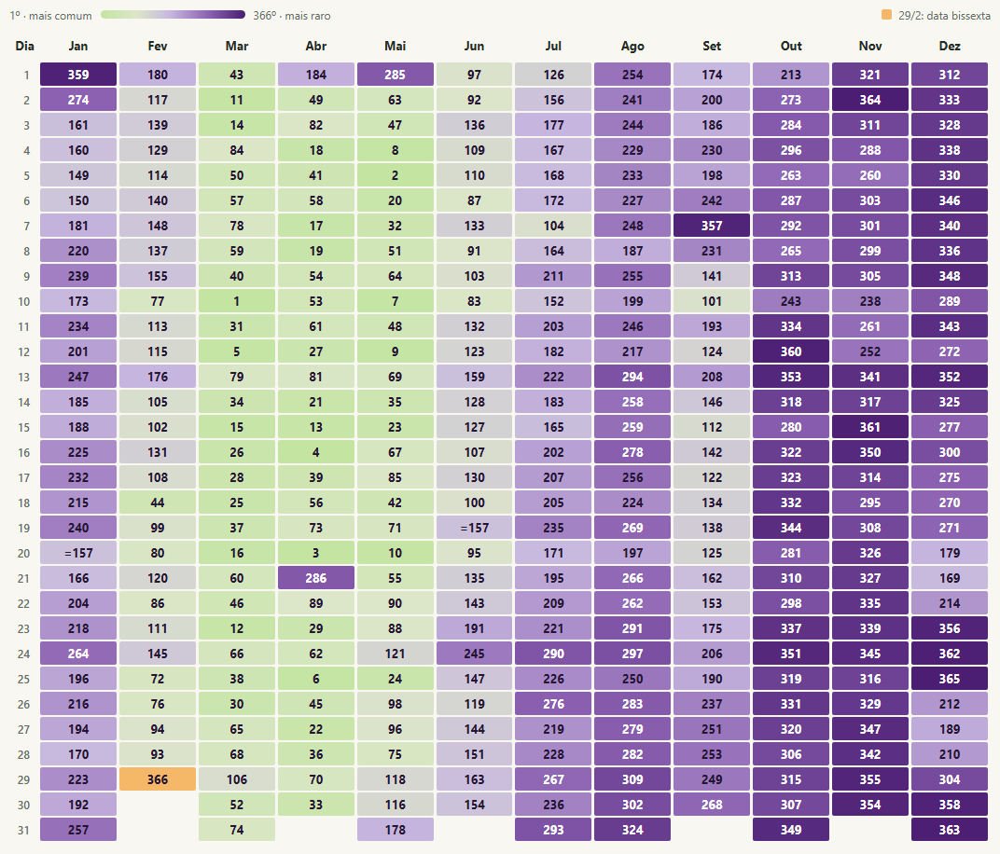

# Quão comum é o seu aniversário no Brasil?

Ranking das **366 datas** com base em **76.691.580 nascimentos com data válida** registrados no SINASC, no Brasil, de **1997 a 2022**.

## Calendário de aniversários

Encontre o **dia na linha** e o **mês na coluna**. O número na célula é a posição pelo total de nascimentos no período: **1º = mais comum; 366º = mais raro**. Verde indica posições mais frequentes, roxo escuro as mais raras e laranja destaca **29/2**. As cores mostram a ordem do ranking. O sinal `=` indica empate; células vazias são datas que não existem.

Se quiser explorar as contagens de cada dia ou alternar para o ranking pela média, baixe o [`index.html`](index.html) e abra no navegador.

## O que os dados mostram

- **10 de março** foi a data mais frequente, com **234.249 nascimentos**.
- **29 de fevereiro** ficou em **366º**, com **45.610 nascimentos**. Como a data apareceu só seis vezes no período, ela sobe para **310º** quando se compara a média por ocorrência.
- **25 de dezembro** foi a data menos frequente entre as que existem todos os anos: **145.367 nascimentos**, ou cerca de **5.591 por ocorrência**, a menor média do ranking.

## Dados e metodologia

- [`aniversarios-brasil.csv`](aniversarios-brasil.csv): total, média e posição nos dois rankings para cada combinação de dia e mês.
- [`nascimentos-por-data-1997-2022.csv`](nascimentos-por-data-1997-2022.csv): contagens nacionais por data completa. Os CSVs usam ponto e vírgula como separador.

O cálculo agrupa os registros pela data de nascimento (`DTNASC`). Dos 76.691.677 registros lidos, 97 foram excluídos por data inválida. A média usa 26 ocorrências por data, ou 6 para 29 de fevereiro. O recorte descreve nascimentos registrados no período; a distribuição dos aniversários da população brasileira viva pode ser diferente.

A fonte é o [SINASC, do Ministério da Saúde](https://dadosabertos.saude.gov.br/dataset/sistema-de-informacao-sobre-nascidos-vivos-sinasc). As contagens foram calculadas a partir da [cópia documentada em Parquet do projeto healthbr-data](https://huggingface.co/datasets/SidneyBissoli/sinasc), com 702 arquivos das 27 unidades da federação. O HTML inclui mais detalhes, a conferência anual e referências às pesquisas brasileiras consultadas.
